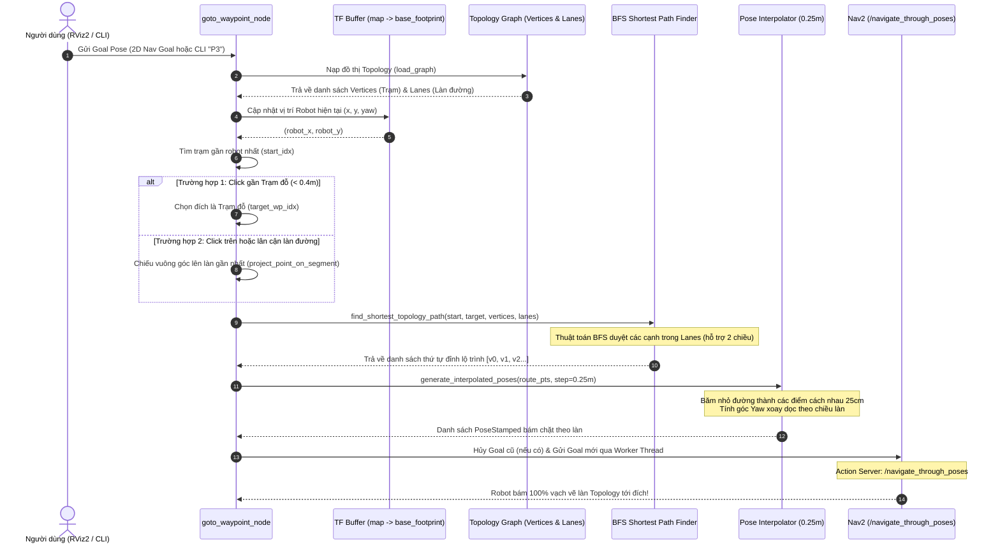

# Hướng Dẫn Vận Hành Định Vị (Localization), Initial Pose & Setup Goal - AMR Robot

Tài liệu hướng dẫn chi tiết quy trình định vị AMCL độc lập, khởi tạo vị trí ban đầu (Initial Pose / Last Known Pose) và thiết lập danh sách điểm đích (Setup Goal) cho Robot AMR.

---

## 1. Kiến Trúc Các Package Liên Quan

| Package | Thư Mục | Chức Năng Chính |
| :--- | :--- | :--- |
| **`mybot_common`** | `src/mybot_common` | Quản lý tập trung các Topic, hằng số đường dẫn (`MAPS_DIR`), các hàm parse JSON/CLI. |
| **`mybot_localization`** | `src/mybot_localization` | Bật AMCL độc lập (`start_localization`), Tắt AMCL (`stop_localization`), Nạp Initial Pose (`initial_pose`), Reset Pose (`reset_pose`). |
| **`mybot_goal`** | `src/mybot_goal` | Tạo Goal (`create_goal`), Cập nhật Goal (`update_goal`), Xóa Goal (`delete_goal`), Đọc danh sách Goal (`get_goals`). |
| **`mybot_navigation2_tablet`** | `src/mybot_navigation2_tablet` | Cầu nối backend phục vụ toàn bộ nút bấm từ giao diện Web UI / App di động (`tablet_bridge.launch.py`). |

---

## 2. Quy Trình Vận Hành 5 Bước Từ A -> Z

```text
Bước 1: Launch Gazebo & RViz2 ──► Bước 2: Launch Backend Bridge (tablet_bridge) ──► Bước 3: Launch Nav2 Navigation
                                                                                          │
                                                                                          ▼
                                                                            Bước 4: Setup Goal bằng Nav2 TF (use_current_pose)
```

> [!TIP]
> Hệ thống hỗ trợ bắt tọa độ tự động trực tiếp từ Nav2 TF tree (`map` -> `base_footprint`). Bạn có thể chạy ngay Nav2 Navigation Stack (`navigation2.launch.py`) và tạo Goal mà không cần chạy riêng AMCL độc lập (`/localization/start`).

### Bước 1: Khởi động Mô phỏng Gazebo & RViz2
Mở **Terminal 1** và chạy:
```bash
source install/setup.bash
ros2 launch mybot_navigation2 launch_sim.launch.py
```
*(Màn hình 3D Gazebo và cửa sổ đồ họa RViz2 sẽ mở ra hiển thị robot)*

---

### Bước 2: Khởi động Cầu Nối Web UI / App Backend (`tablet_bridge`)
Mở **Terminal 2** và chạy:
```bash
source install/setup.bash
ros2 launch mybot_navigation2_tablet tablet_bridge.launch.py
```
*(Tự động bật sẵn WebSocket Port 9090, Robot Status, Map Manager, Mapping Lifecycle, **Localization Manager**, **Goal Manager**)*

---

### Bước 3: Bật Định Vị AMCL & Đặt Vị Trí Ban Đầu (Initial Pose)

Mở **Terminal 3** và thực hiện:

1. **Khởi động AMCL độc lập cho bản đồ `map_lab20`**:
   ```bash
   ros2 topic pub --once /localization/start std_msgs/msg/String 'data: "{\"map_name\": \"map_lab20\", \"use_sim_time\": true}"'
   ```

2. **Nạp vị trí Robot đang đứng hiện tại để khởi tạo Nav2 (Current Pose)**:
   ```bash
   ros2 topic pub --once /localization/initial_pose std_msgs/msg/String 'data: "{\"use_current_pose\": true}"'
   ```

---

### Bước 4: Lái Robot & Thiết Lập Các Điểm Goal (Setup Goal)

1. **Mở bàn phím lái tay robot (Terminal 4)**:
   ```bash
   ros2 run teleop_twist_keyboard teleop_twist_keyboard
   ```

2. **Lái robot tới từng điểm dừng và phát lệnh lưu (Terminal 3)**:
   - **Bàn 1 (`P1`)**:
     ```bash
     ros2 topic pub --once /goal_manager/create_goal std_msgs/msg/String 'data: "{\"map_name\": \"map_lab20\", \"goal_id\": \"P1\", \"name\": \"Bàn 1\", \"use_current_pose\": true}"'
     ```
   - **Bàn 2 (`P2`)**:
     ```bash
     ros2 topic pub --once /goal_manager/create_goal std_msgs/msg/String 'data: "{\"map_name\": \"map_lab20\", \"goal_id\": \"P2\", \"name\": \"Bàn 2\", \"use_current_pose\": true}"'
     ```
   - **Trạm Sạc (`P3`)**:
     ```bash
     ros2 topic pub --once /goal_manager/create_goal std_msgs/msg/String 'data: "{\"map_name\": \"map_lab20\", \"goal_id\": \"P3\", \"name\": \"Trạm Sạc\", \"use_current_pose\": true}"'
     ```

3. **Xem danh sách tất cả các điểm Goal đã lưu**:
   ```bash
   ros2 topic pub --once /goal_manager/get_goals_req std_msgs/msg/String 'data: "map_lab20"'
   ```
   *(Lắng nghe dữ liệu trả về: `ros2 topic echo --no-str-trunc /goal_manager/goals_list`)*

---

### Bước 5: Cho Robot Tự Động Lái Đến Goal Bằng Nav2

Khởi chạy Nav2 Navigation Stack *(hệ thống tự động ngắt AMCL độc lập cũ và chuyển sang Nav2 Navigation)*:

```bash
source install/setup.bash
ros2 launch mybot_navigation2 navigation2.launch.py map:=/home/nam/ROBOT_AMR_LAB20_07/AMR_Simulation/AMR_Simulation/src/mybot_navigation2/map/map_lab20.yaml use_sim_time:=true
```

Ra lệnh cho Robot tự lái tới **Bàn 1 (`P1`)**:
```bash
ros2 action send_goal /navigate_to_pose nav2_msgs/action/NavigateToPose "{pose: {header: {frame_id: 'map'}, pose: {position: {x: 2.213, y: 0.0, z: 0.0}, orientation: {w: 1.0}}}}"
```

---

## 3. Bảng Tổng Hợp Topic & Định Dạng JSON

| Chức Năng | Topic Nhận Lệnh | Định Dạng Payload JSON |
| :--- | :--- | :--- |
| **Bật AMCL Độc Lập** | `/localization/start` | `{"map_name": "map_lab20", "use_sim_time": true}` |
| **Dừng AMCL** | `/localization/stop` | `{"command": "stop"}` |
| **Initial Pose (Current Pose)** | `/localization/initial_pose` | `{"use_current_pose": true}` |
| **Reset Pose về (0,0,0)** | `/localization/reset_pose` | `{"command": "reset"}` |
| **Tạo Điểm Goal (Create Goal)** | `/goal_manager/create_goal` | `{"map_name": "map_lab20", "goal_id": "P1", "name": "Bàn 1", "use_current_pose": true}` |
| **Lấy Danh Sách Goal** | `/goal_manager/get_goals_req` | `{"data": "map_lab20"}` |
| **Xóa Điểm Goal** | `/goal_manager/delete_goal` | `{"map_name": "map_lab20", "goal_id": "P1"}` |

---

## 4. Toàn Bộ Luồng Điều Hướng Sau Khi Đã Nạp Topology (Topology-Constrained Navigation)

Luồng điều hướng bám làn 100% theo các nét vẽ Topology RMF (Open-RMF Lanes) thay vì để Robot chạy tự do:

### A. Sơ Đồ Trình Tự Thực Thi (Sequence Diagram)



### B. Các Bước Xử Lý Cốt Lõi Trong Thuật Toán

1. **Xác định vị trí robot & điểm trạm xuất phát (`start_idx`)**:
   - Tra cứu TF `map` $\to$ `base_footprint` lấy tọa độ thực thời của robot.
   - Quét mảng `vertices` để tìm đỉnh trạm có khoảng cách Euclid nhỏ nhất tới vị trí robot.

2. **Phân loại mục tiêu di chuyển**:
   - **Click trạm đỗ (Khoảng cách < 0.4m)**: Dẫn hướng trực tiếp tới tâm trạm đó.
   - **Click điểm tự do lân cận làn**: Sử dụng giải thuật hình học `project_point_on_segment` để tìm điểm hình chiếu vuông góc gần nhất trên đoạn thẳng làn đường (`best_proj`). Robot sẽ chạy bám theo làn đến hình chiếu rồi mới rẽ ra vị trí click.

3. **Tìm đường ngắn nhất trên đồ thị làn (`BFS`)**:
   - Dựng đồ thị kề `adj` từ danh sách `lanes` (kiểm tra cờ hai chiều `is_bidirectional`).
   - Sử dụng hàng đợi BFS duyệt tìm chuỗi đỉnh đi qua ít cạnh nhất từ `start_idx` tới `target_idx`.

4. **Nội suy tọa độ dày đặc (Interpolation step = 0.25m)**:
   - Dọc theo các đoạn thẳng giữa các đỉnh, cứ mỗi `0.25m` sinh ra một `PoseStamped` với vector góc hướng `yaw = atan2(dy, dx)`.
   - Giúp Local Planner của Nav2 bám chính xác vào vạch vẽ ảo như xe chạy trên đường ray.

5. **Thực thi điều hướng bất đồng bộ (Asynchronous Threading)**:
   - Hủy bỏ Goal Nav2 cũ nếu đang chạy (`cancel_active_navigation`).
   - Khởi chạy tiến trình riêng `_navigation_worker` gọi Action `/navigate_through_poses`, đảm bảo không làm khóa luồng hoặc nghẽn ROS 2 Executor khi người dùng click điểm liên tiếp.
