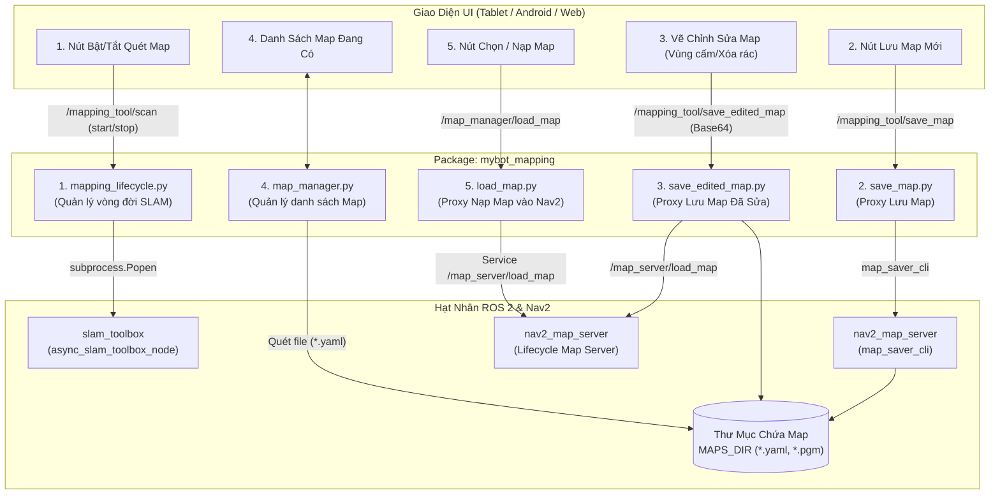

# Kiến Trúc Quét Map & Quản Lý Bản Đồ (mybot_mapping)

Package **`mybot_mapping`** đóng vai trò là tầng **Backend Proxy & Lifecycle Manager** kết nối giữa **Giao diện điều khiển (Android Tablet / Web App qua WebSocket)** và **Hạt nhân SLAM / Map Server của ROS 2**.

---

## 1. Sơ Đồ Tổng Thể Kiến Trúc Mapping

---

## 2. Chi Tiết 5 Module Nghiệp Vụ

### 2.1. `mapping_lifecycle.py` — Quản Lý Vòng Đời SLAM
- **Chức năng:** Điều khiển bật/tắt thuật toán SLAM theo yêu cầu từ Tablet. Tránh việc SLAM chạy ngầm liên tục gây tốn CPU và xung đột TF với Nav2 AMCL.
- **Topic nhận lệnh:** `/mapping_tool/scan` (`std_msgs/String`: `"start"` hoặc `"stop"`).
- **Topic trạng thái:** `/mapping_tool/scan_status`.
- **Hạt nhân SLAM:** Kích hoạt `async_slam_toolbox_node` (`slam_toolbox`) qua `subprocess.Popen`:
  - `scan_topic: /scan`, `max_laser_range: 12.0m`.
  - Khung tọa độ liên kết: `map` $\to$ `odom` $\to$ `base_link`.
  - `map_update_interval: 2.0s`.

### 2.2. `save_map.py` — Lưu Bản Đồ Quét Được
- **Chức năng:** Xuất bản đồ hiện tại ra file cấu hình trên ổ đĩa.
- **Topic nhận lệnh:** `/mapping_tool/save_map` (JSON: `{"map_name": "map_lab20"}`).
- **Topic phản hồi:** `/mapping_tool/save_map_result`.
- **Thực thi:** Gọi lệnh `ros2 run nav2_map_server map_saver_cli -f <MAPS_DIR>/<map_name>` với thời gian timeout 30s để xuất ra cặp file `<map_name>.yaml` và `<map_name>.pgm`.

### 2.3. `save_edited_map.py` — Lưu Bản Đồ Chỉnh Sửa Từ UI
- **Chức năng:** Tiếp nhận ảnh bản đồ sau khi người dùng vẽ thêm vùng cấm (tường ảo) hoặc tẩy xóa các vết nhiễu của cảm biến trên Tablet.
- **Topic nhận lệnh:** `/mapping_tool/save_edited_map` chứa ảnh dạng chuỗi Base64 (`image_base64`).
- **Topic phản hồi:** `/mapping_tool/save_edited_map_result`.
- **Thực thi:** Giải mã ảnh bằng `PIL (Pillow)`, ghi đè file ảnh và tự động gọi Service `/map_server/load_map` của Nav2 để tải lại bản đồ ngay lập tức mà không cần khởi động lại hệ thống.

### 2.4. `map_manager.py` — Quản Lý Danh Mục Bản Đồ
- **Chức năng:** Quét thư mục lưu map (`MAPS_DIR`), cung cấp danh sách tên bản đồ khả dụng cho Tablet.
- **Topic yêu cầu:** `/map_manager/get_available_maps_req` (`std_msgs/Bool`).
- **Topic xuất bản:** `/map_manager/available_maps` (JSON string array: `["big_map2", "map_lab20", ...]`).
- **Cơ chế Timer:** Tự động phát lại danh sách định kỳ `1.0 Hz` để Tablet / App vừa kết nối WebSocket là có danh sách map ngay lập tức.

### 2.5. `load_map.py` — Nạp & Chuyển Đổi Bản Đồ
- **Chức năng:** Nhận yêu cầu nạp bản đồ cụ thể từ người dùng và đẩy lên hệ thống.
- **Topic nhận lệnh:** `/map_manager/load_map` (tên map).
- **Topic phản hồi:** `/map_manager/load_map_result`.
- **Cơ chế tải kép (Dual-Load):**
  - **Nếu Nav2 đang chạy:** Gọi trực tiếp Service `/map_server/load_map` để hot-reload map.
  - **Nếu Nav2 chưa chạy:** Tự động kích hoạt tiến trình `nav2_map_server` độc lập để phát topic `/map` phục vụ xem trước bản đồ.
  - Tự động gọi đồng bộ danh sách mục tiêu điểm Goal (`/goal_manager/available_goals`) tương ứng với map được nạp.

---

## 3. Bảng Tổng Hợp Topic & Giao Thức JSON

| Module | Topic Lắng Nghe | Kiểu Message | Định Dạng Dữ Liệu Gửi | Topic Phản Hồi |
| :--- | :--- | :--- | :--- | :--- |
| **Bật/Tắt SLAM** | `/mapping_tool/scan` | `std_msgs/String` | `{"command": "start"}` hoặc `"stop"` | `/mapping_tool/scan_status` |
| **Lưu Map** | `/mapping_tool/save_map` | `std_msgs/String` | `{"map_name": "lab20"}` | `/mapping_tool/save_map_result` |
| **Lưu Map Đã Sửa** | `/mapping_tool/save_edited_map` | `std_msgs/String` | `{"map_name": "lab20", "image_base64": "...", "overwrite": true}` | `/mapping_tool/save_edited_map_result` |
| **Yêu Cầu Danh Sách Map** | `/map_manager/get_available_maps_req` | `std_msgs/Bool` | `true` | `/map_manager/available_maps` |
| **Nạp Map Vào Hệ Thống** | `/map_manager/load_map` | `std_msgs/String` | `"lab20"` hoặc `{"map_name": "lab20"}` | `/map_manager/load_map_result` |

