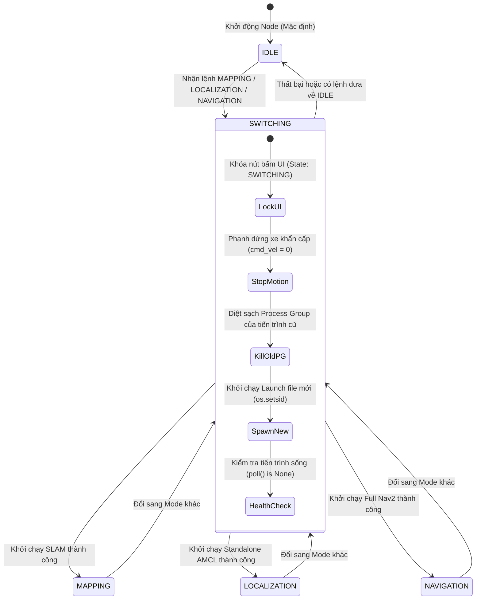
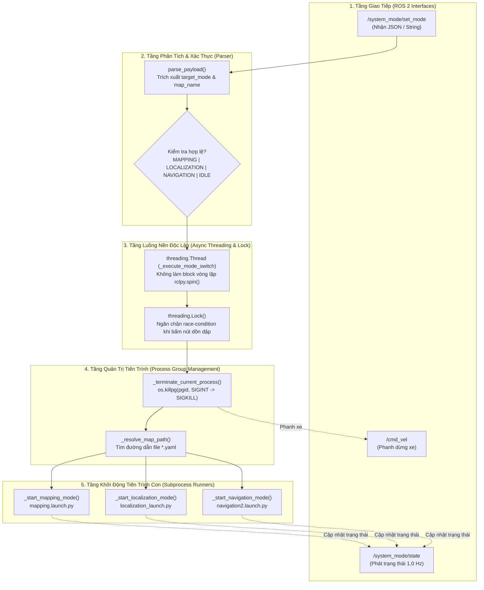

# mybot_mode_manager

Package ROS 2 Python quản lý và chuyển đổi các chế độ hoạt động cốt lõi của Robot AMR:
- **`MAPPING`**: Tự động kích hoạt SLAM Mapping (`mapping.launch.py`) để quét tạo bản đồ.
- **`LOCALIZATION`**: Tự động kích hoạt Standalone AMCL (`localization_launch.py`) để định vị phục vụ dạy điểm, vẽ tường ảo, xóa noise.
- **`NAVIGATION`**: Tự động kích hoạt Nav2 Navigation (`navigation2.launch.py`) để điều hướng tự động.
- **`IDLE`**: Dừng toàn bộ các tiến trình mapping/navigation và dập phanh an toàn.

---

## 1. Vai Trò Cốt Lõi (Central Coordinator)

Trong hệ thống AMR, các hệ thống con lớn (**SLAM**, **AMCL Localization**, **Nav2 Navigation**) không bao giờ được chạy đồng thời vì sẽ gây xung đột chiếm dụng cảm biến LiDAR và đè gãy cây tọa độ TF (`map -> odom`).

`mode_manager_node` đóng vai trò là **"Nhạc trưởng" điều phối toàn hệ thống**:
- **Nhận lệnh chuyển chế độ** từ Tablet/Web UI thông qua WebSocket.
- **Quản lý vòng đời** (bật/tắt an toàn) các launch file lớn tương ứng mà không cần SSH vào robot.
- **Phanh dừng xe khẩn cấp** trước khi chuyển đổi trạng thái để đảm bảo an toàn cơ khí.
- **Báo cáo phản hồi liên tục** trạng thái hiện tại lên UI (tránh người dùng bấm loạn nút khi hệ thống đang khởi động).

---

## 2. Máy Trạng Thái Hữu Hạn (Finite State Machine - FSM)



---

## 3. Kiến Trúc 5 Tầng Xử Lý Bên Trong Code



---

## 4. Bốn Cơ Chế Kỹ Thuật Quan Trọng Nhất Trong Code

### 1. Cơ Chế Diệt Tiến Trình Con Bằng Process Group (`os.killpg`)
- **Vấn đề thực tế:** Khi chạy `ros2 launch`, lệnh này sẽ sinh ra hàng chục tiến trình con (`amcl`, `map_server`, `bt_navigator`, `planner_server`...). Nếu chỉ dùng `process.terminate()`, hệ điều hành chỉ tắt được tiến trình cha, các tiến trình con vẫn sống ngầm ("zombie") và tiếp tục chiếm LiDAR/TF.
- **Giải pháp trong code (L218-L238):**
  1. Khi khởi chạy (`subprocess.Popen`), gán cờ `preexec_fn=os.setsid` để biến toàn bộ các node con vào cùng một **Process Group ID (PGID)** mới.
  2. Khi dừng, lấy `pgid = os.getpgid(self.current_process.pid)` và gửi tín hiệu:  
     `os.killpg(pgid, signal.SIGINT)` $\rightarrow$ Chờ 3s, nếu còn sống thì `os.killpg(pgid, signal.SIGKILL)`.  
  $\rightarrow$ Đảm bảo dọn dẹp sạch sẽ 100% không để sót bất kỳ tiến trình nào chạy ngầm!

### 2. Cơ Chế Chuyển Mode Bất Đồng Bộ (Non-blocking Async Switching)
- Việc bật/tắt Nav2 hoặc SLAM tốn từ 2 đến 4 giây (đợi nạp map, khởi tạo lifecycle).
- Nếu chạy trực tiếp trong callback `on_set_mode_received`, nó sẽ làm "đóng băng" toàn bộ vòng xoay của node (`rclpy.spin()`), khiến WebSocket bị timeout hoặc disconnect.
- **Giải pháp trong code (L153-L157):**  
  Node tách việc chuyển đổi sang một `threading.Thread` riêng, kết hợp khóa `threading.Lock()`. Nhờ đó, node vẫn duy trì bắn nhịp tim 1Hz lên `/system_mode/state` mượt mà trong khi tiến trình ngầm đang khởi tạo.

### 3. Cơ Chế An Toàn Chuyển Động (`stop_robot_motion`)
- Trước khi tắt tiến trình cũ ở dòng L167, node tự động bắn 3 lần gói tin vận tốc bằng `0.0` vào `/cmd_vel` để đảm bảo xe dừng hẳn trước khi chuyển trạng thái, tránh việc robot bị trôi trớn do mất controller đột ngột.

### 4. Cơ Chế Tự Động Phân Giải Bản Đồ (`_resolve_map_path`)
- Hàm này tự động phân giải tên map: người dùng gửi `"map_lab20"`, `"map_lab20.yaml"` hay `"map_lab20.pgm"` đều được chuẩn hóa.
- Quét tìm theo thứ tự: thư mục cài đặt share của package $\rightarrow$ thư mục source `src/mybot_navigation2/map/` $\rightarrow$ tự động fallback về map mặc định nếu file không tồn tại.

---

## 5. Bảng Tổng Hợp Các Chế Độ (System Modes)

| Mode | Ý Nghĩa Nghiệp Vụ | Launch File Được Kích Hoạt | Ứng Dụng Thực Tế |
| :--- | :--- | :--- | :--- |
| **`IDLE`** | Trạng thái nghỉ | Không có (Dọn dẹp sạch mọi tiến trình) | Xe đứng rảnh rỗi tại chỗ, bảo tồn CPU và pin. |
| **`MAPPING`** | Quét bản đồ mới | `mybot_navigation2/launch/mapping.launch.py` | Lái xe vòng quanh xưởng để quét và lưu map. |
| **`LOCALIZATION`** | Định vị độc lập | `nav2_bringup/launch/localization_launch.py` | **Vẽ tường ảo, xóa noise, dạy vị trí các trạm/bàn**. |
| **`NAVIGATION`** | Điều hướng tự động | `mybot_navigation2/launch/navigation2.launch.py` | Chạy nhiệm vụ giao hàng, tuần tra tự động. |
| **`SWITCHING`** | Đang chuyển giao | (Trạng thái chuyển tiếp nội bộ) | Báo hiệu cho UI khóa toàn bộ nút bấm & hiển thị spinner. |

---

## 6. Giao Thức WebSocket / ROSBridge Chuẩn Cho Tablet UI

### A. Topic Gửi Lệnh Chuyển Chế Độ (Tablet UI $\rightarrow$ Robot)
- **Topic**: `/system_mode/set_mode`
- **Kiểu dữ liệu**: `std_msgs/msg/String`
- **Gói tin Raw WebSocket JSON**:

#### 1. Bật Mapping:
```json
{
  "op": "publish",
  "topic": "/system_mode/set_mode",
  "type": "std_msgs/msg/String",
  "msg": { "data": "MAPPING" }
}
```

#### 2. Bật Standalone Localization (Setup, Dạy Điểm & Vẽ Tường Ảo):
```json
{
  "op": "publish",
  "topic": "/system_mode/set_mode",
  "type": "std_msgs/msg/String",
  "msg": { "data": "{\"mode\": \"LOCALIZATION\", \"map_name\": \"map_lab20\"}" }
}
```

#### 3. Bật Navigation:
```json
{
  "op": "publish",
  "topic": "/system_mode/set_mode",
  "type": "std_msgs/msg/String",
  "msg": { "data": "{\"mode\": \"NAVIGATION\", \"map_name\": \"map_lab20\"}" }
}
```

#### 4. Dừng / IDLE:
```json
{
  "op": "publish",
  "topic": "/system_mode/set_mode",
  "type": "std_msgs/msg/String",
  "msg": { "data": "IDLE" }
}
```

---

### B. Topic Phản Hồi Trạng Thái (Robot $\rightarrow$ Tablet UI)
- **Topic**: `/system_mode/state`
- **Kiểu dữ liệu**: `std_msgs/msg/String`
- **Tần số**: Bắn ngay khi chuyển trạng thái + lặp lại định kỳ 1.0 Hz (để Tablet kết nối lại vẫn nhận được).
- **Subscribe từ Tablet UI**:
```json
{
  "op": "subscribe",
  "topic": "/system_mode/state",
  "type": "std_msgs/msg/String"
}
```
- **Các giá trị trạng thái**:
  - `"SWITCHING"`: Đang trong quá trình tắt tiến trình cũ và khởi chạy tiến trình mới (UI hiển thị loading/spinner và khóa nút).
  - `"MAPPING"`: Chế độ SLAM đã sẵn sàng (UI mở khóa, hiển thị trạng thái Mapping).
  - `"LOCALIZATION"`: Chế độ Định vị độc lập đã sẵn sàng (UI mở công cụ dạy điểm, sửa map).
  - `"NAVIGATION"`: Chế độ Nav2 đã sẵn sàng (UI mở khóa, hiển thị trạng thái Navigation).
  - `"IDLE"`: Hệ thống đang nghỉ (UI hiển thị IDLE).

---

## 7. Quy Trình UI Frontend Khuyến Nghị

```typescript
// Định nghĩa kiểu dữ liệu TypeScript
export type SystemMode = "MAPPING" | "LOCALIZATION" | "NAVIGATION" | "IDLE";
export type SystemState = SystemMode | "SWITCHING";

// Luồng xử lý nút bấm:
function setRobotMode(targetMode: SystemMode, mapName?: string) {
  // 1. Khoá nút, hiện loading
  setLoading(true);
  
  // 2. Publish gói tin lên /system_mode/set_mode
  setModeTopic.publish({
    data: JSON.stringify({ mode: targetMode, map_name: mapName || "map_lab20" })
  });
}

// Lắng nghe topic /system_mode/state
stateTopic.subscribe((message) => {
  const currentState = message.data as SystemState;
  
  if (currentState === "SWITCHING") {
    // Đang chuyển đổi -> tiếp tục hiện loading
    setLoading(true);
  } else {
    // Đã chuyển xong (MAPPING | LOCALIZATION | NAVIGATION | IDLE) -> tắt loading
    setLoading(false);
    setCurrentMode(currentState);
  }
});
```

---

## 8. Cách Build & Chạy

### Build package:
```bash
cd ~/ROBOT_AMR_LAB20_07/AMR_Simulation/AMR_Simulation
source /opt/ros/humble/setup.bash
colcon build --packages-select mybot_mode_manager --symlink-install
source install/setup.bash
```

### Chạy Node:
```bash
ros2 launch mybot_mode_manager mode_manager.launch.py use_sim_time:=true
```

---

## 9. Test Bằng ROS 2 CLI

```bash
# 1. Mở một terminal theo dõi trạng thái:
ros2 topic echo /system_mode/state

# 2. Bật Mapping:
ros2 topic pub --once /system_mode/set_mode std_msgs/msg/String '{"data": "MAPPING"}'

# 3. Bật Localization (Setup mode):
ros2 topic pub --once /system_mode/set_mode std_msgs/msg/String '{"data": "{\"mode\": \"LOCALIZATION\", \"map_name\": \"map_lab20\"}"}'

# 4. Bật Navigation:
ros2 topic pub --once /system_mode/set_mode std_msgs/msg/String '{"data": "{\"mode\": \"NAVIGATION\", \"map_name\": \"map_lab20\"}"}'

# 5. Về IDLE:
ros2 topic pub --once /system_mode/set_mode std_msgs/msg/String '{"data": "IDLE"}'
```
