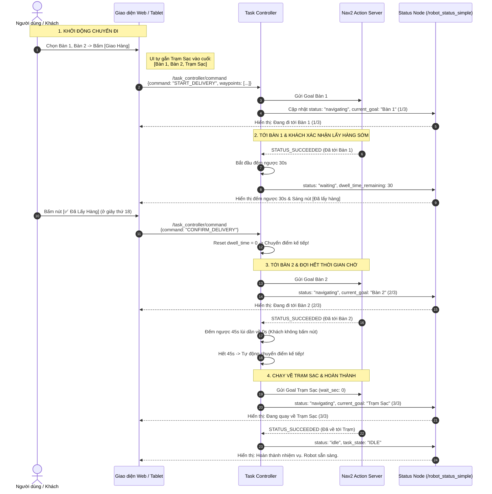
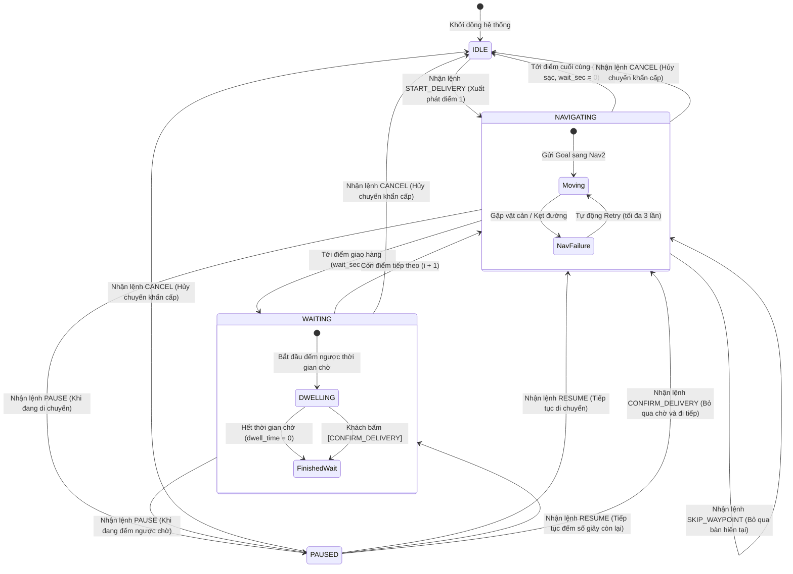

# mybot_task_controller

Package ROS 2 Python điều khiển hành trình Robot AMR thực thi theo **từng điểm Waypoint (Point-by-Point Sequential Navigation & Delivery)**:
- **Chạy theo từng điểm chỉ định, KHÔNG loop tuần hoàn liên tục**.
- Đến từng điểm $\rightarrow$ Dừng đếm thời gian chờ (Dwell time) để giao hàng/lấy hàng.
- Hoàn tất lượt giao $\rightarrow$ **Tự động quay về trạm (`RETURNING_HOME`)** $\rightarrow$ Về đến nơi chuyển sang **`IDLE`** và xuất báo cáo thống kê.

---

## 1. Biểu Đồ Trình Tự Tương Tác (Sequence Diagram)



---

## 2. Biểu Đồ Máy Trạng Thái (State Diagram)



---

## 3. Giao Thức Lệnh WebSocket Chuẩn Cho UI

### A. Giao Hàng Chuỗi Điểm (Multi-Point Delivery, UI tự đặt trạm sạc làm điểm cuối):
Xe đi lần lượt Bàn 1 $\rightarrow$ Bàn 2 (mỗi điểm dừng chờ đúng số giây) $\rightarrow$ Điểm cuối cùng là Trạm Sạc (chờ 0s) $\rightarrow$ Về đến trạm chuyển ngay sang **`IDLE`**:

```json
{
  "command": "START_DELIVERY",
  "map_name": "big_map2",
  "waypoints": [
    { "goal_id": "BAN_1", "name": "Bàn 1", "wait_sec": 30 },
    { "goal_id": "BAN_2", "name": "Bàn 2", "wait_sec": 45 },
    { "goal_id": "TRAM_SAC", "name": "Trạm Sạc", "wait_sec": 0 }
  ]
}
```

### B. Nút Bấm Thao Tác Nhanh:
* **Khách lấy hàng xong sớm (Đi tiếp ngay hoặc về Trạm)**:
  ```json
  { "command": "CONFIRM_DELIVERY" }
  ```
  *(Robot nhận diện cả: `"DA_LAY_HANG"`, `"CONFIRM"`, `"NEXT"`, `"SKIP_WAIT"`)*
* **Tạm dừng**: `{"command": "PAUSE"}` (đóng băng timer chờ hoặc phanh dừng xe)
* **Tiếp tục**: `{"command": "RESUME"}`
* **Bỏ qua bàn hiện tại**: `{"command": "SKIP_WAYPOINT"}`
* **Hủy khẩn cấp**: `{"command": "CANCEL"}`

---

## 4. Trạng Thái Phản Hồi Định Kỳ 1.0 Hz (`/task_controller/status`)

```json
{
  "state": "WAITING",
  "sub_state": "DWELLING",
  "mission_type": "DELIVERY",
  "mission_id": "delivery_1793762668",
  "current_waypoint_index": 0,
  "total_waypoints": 3,
  "current_goal_id": "BAN_1",
  "current_goal_name": "Bàn 1",
  "dwell_time_remaining": 24,
  "battery_percent": 96.5,
  "is_paused": false,
  "loop": false,
  "statistics": {
    "completed_count": 1,
    "skipped_count": 0,
    "elapsed_time_sec": 85
  },
  "message": "Giao hàng tại Bàn 1 (24s còn lại)",
  "timestamp": 1793762700
}
```

* **Vòng đời State**:
  - `NAVIGATING`: Đang chạy trên đường tới điểm giao hàng.
  - `WAITING` (hoặc `DELIVERING`): Đang dừng tại bàn đếm ngược dwell time để khách lấy đồ.
  - `IDLE`: Đã về đến trạm sạc an toàn, sẵn sàng cho đơn tiếp theo!

---

## 5. Cách Chạy & Kiểm Thử

```bash
source /opt/ros/humble/setup.bash
source ~/ROBOT_AMR_LAB20_07/AMR_Simulation/AMR_Simulation/install/setup.bash
ros2 launch mybot_task_controller task_controller.launch.py use_sim_time:=true
```

Test giao hàng đến bàn `P1` (chờ 30s rồi tự về Home):
```bash
ros2 topic pub --once /task_controller/command std_msgs/msg/String '{"data": "{\"command\": \"START_DELIVERY\", \"goal_id\": \"P1\", \"wait_sec\": 30}"}'
```
