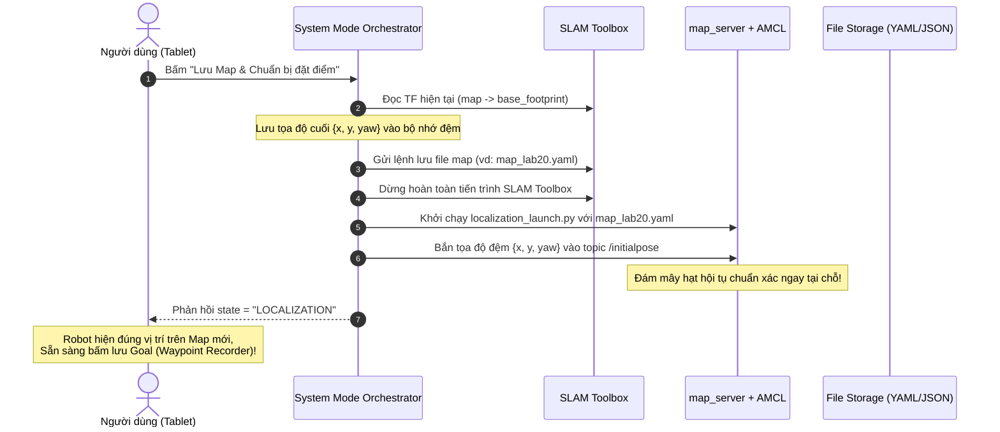
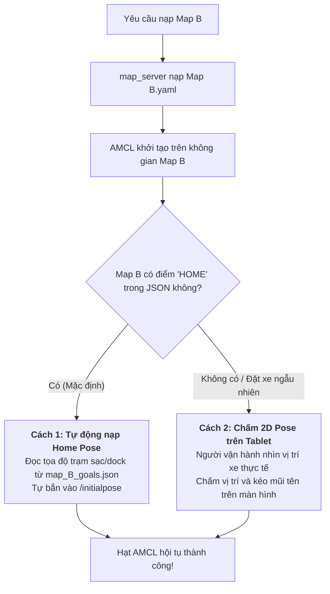

# Kiến Trúc Quản Lý Chế Độ Hoạt Động & Định Vị AMR (System Mode & Navigation Architecture)

Tài liệu này chuẩn hóa toàn bộ kiến trúc điều phối tiến trình giữa **Mapping (SLAM)**, **Localization (AMCL)**, và **Navigation (Nav2)** cho hệ thống Robot AMR, kết nối điều khiển với Tablet/Web UI qua ROSBridge WebSocket.

---

## 1. Nguyên Lý Cốt Lõi: Kiến Trúc Xếp Chồng (Layered Architecture)

Trong ROS 2, cây biến đổi tọa độ TF bắt buộc phải là một cây đơn nhất:
$$\text{map} \longrightarrow \text{odom} \longrightarrow \text{base_link}$$

Tuyệt đối **không chạy gộp** hay để SLAM và AMCL cùng phát biến đổi `map -> odom`. Thay vào đó, hệ thống được phân tách theo các lớp xếp chồng vi sai:

```text
+-------------------------------------------------------------------------+
|                  APPLICATION LAYER: Task / Patrol Controller            |
|                (Chạy tuần tra waypoint, đếm dwell time, pin)            |
+-------------------------------------------------------------------------+
                                    ▲
+-------------------------------------------------------------------------+
|      NAVIGATION STACK: Planner, Controller, Costmaps, BT Navigator       |
|              (Khởi chạy riêng qua navigation_launch.py)                 |
+-------------------------------------------------------------------------+
                                    ▲
+-------------------------------------------------------------------------+
|      LOCALIZATION LAYER: Static Map Server + AMCL (Particle Filter)     |
|              (Khởi chạy riêng qua localization_launch.py)               |
+-------------------------------------------------------------------------+
                                    ▲
+-------------------------------------------------------------------------+
|             BASE & ODOMETRY: Drivers, LiDAR, IMU, EKF, Twist Mux        |
|                   (Luôn luôn hoạt động - Always Running)                |
+-------------------------------------------------------------------------+
```

### Quy Tắc Chuyển Đổi Không Gián Đoạn:
* Khi chuyển từ `LOCALIZATION` sang `NAVIGATION`: **Giữ nguyên** `map_server + AMCL` đang chạy, **chỉ bật thêm** `navigation_launch.py`. 
* Lợi ích: Robot **không bị reset AMCL**, không mất đám mây hạt (particle cloud), không bị giật hình và **không phải nạp lại Initial Pose**.

---

## 2. Bảng Ma Trận Tiến Trình (Mode Matrix)

Bộ điều phối trung tâm (`mode_manager_node`) so sánh trạng thái hiện tại với trạng thái đích và chỉ bật/tắt phần chênh lệch:

| Mode Hệ Thống | `slam_toolbox` | `map_server` + `AMCL` | `Nav2 Stack` (Planner, Controller) | `Patrol Controller` (App) | Mục Đích Sử Dụng |
| :--- | :---: | :---: | :---: | :---: | :--- |
| **`IDLE`** | ❌ Tắt | ❌ Tắt | ❌ Tắt | ❌ Tắt | Robot nghỉ an toàn, xem pin, chọn map |
| **`MAPPING`** |  **Bật** | ❌ Tắt | ❌ Tắt | ❌ Tắt | Quét tạo bản đồ bằng Teleop |
| **`LOCALIZATION`** | ❌ Tắt |  **Bật** | ❌ Tắt | ❌ Tắt | Nhẹ máy, chuyên dùng để đặt/ghi điểm (Waypoint Recorder) |
| **`NAVIGATION`** | ❌ Tắt |  **Giữ nguyên** |  **Bật thêm** |  Tùy chọn | Tự hành theo waypoint, bám làn, né vật cản |

---

## 3. Phân Định Giao Diện Tablet UI: Mode vs Hành Động (Action)

Để trải nghiệm người dùng trên Tablet không bị nhập nhằng, UI phân tách rõ ràng giữa trạng thái hệ thống và các thao tác nghiệp vụ:

### A. Chế Độ Hệ Thống (System Modes) - Gửi qua `/system_mode/set_mode`
* `IDLE`: Đưa hệ thống về trạng thái nghỉ, dập phanh.
* `MAPPING`: Kích hoạt SLAM.
* `LOCALIZATION`: Kích hoạt Map Server + AMCL.
* `NAVIGATION`: Kích hoạt full Nav2 tự hành.

### B. Hành Động Nghiệp Vụ (Actions / Services)
* `save_map`: Lưu bản đồ SLAM vừa quét (`/mapping_tool/save_map`).
* `save_waypoint`: Ghi nhớ điểm đích hiện tại hoặc chấm trên UI (`/goal_manager/create_goal`).
* `start_patrol` / `pause_patrol` / `resume_patrol`: Điều khiển chu kỳ tuần tra (`/task_controller/command`).
* `emergency_stop`: Dừng khẩn cấp tức thời qua `twist_mux`.

---

## 4. An Toàn Động Học: Bộ Trộn Vận Tốc `twist_mux`

Để đảm bảo robot không bao giờ bị xung đột giữa lệnh tự hành của Nav2 và lệnh can thiệp của con người, mọi luồng vận tốc đều đi qua `twist_mux` trước khi đến động cơ:

| Nguồn phát lệnh | Topic đầu vào | Mức ưu tiên | Timeout | Mô tả |
| :--- | :--- | :---: | :---: | :--- |
| **Emergency Stop** | `/cmd_vel_e_stop` | **100 (Cao nhất)** | 0.5s | Dập phanh khẩn cấp từ nút đỏ trên UI |
| **Teleop Joystick** | `/cmd_vel_teleop` | **50** | 0.5s | Tay cầm hoặc bàn phím can thiệp lái thủ công |
| **Nav2 Autonomous** | `/cmd_vel_nav` | **10 (Thấp nhất)** | 0.5s | Quỹ đạo điều hướng tự động của Nav2 |

---

## 5. Quy Trình Chuyển Giao: Mapping $\rightarrow$ Localization Đặt Điểm

Khi quét xong bản đồ và muốn chuyển sang đặt điểm đích (Destination/Goal) mà không làm lệch tọa độ:



---

## 6. Phương Án Xử Lý Định Vị Khi Đổi Sang Map Khác (Map A $\rightarrow$ Map B)

Vì mỗi bản đồ có gốc tọa độ $(0, 0, 0)$ độc lập, tọa độ cũ của Map A không thể áp dụng cho Map B. Hệ thống sử dụng chiến lược đa tầng:



### Chi Tiết 4 Phương Án Nhận Diện Vị Trí Ban Đầu:

1. **Auto Home Pose (Khuyến nghị chuẩn AMR)**:
   * Mỗi bản đồ khi tạo xong luôn quy ước có một điểm tên `HOME` (hoặc `CHARGING_DOCK`) lưu trong file `<map_name>_goals.json`.
   * Khi đổi sang map mới, hệ thống tự động đọc tọa độ `HOME` và phát vào `/initialpose`.
   * Thích hợp cho xe tự động chạy từ trạm sạc.
2. **Chấm 2D Pose Estimate trên UI**:
   * Khi người dùng mang xe thả vào một vị trí bất kỳ trong xưởng.
   * Người dùng mở bản đồ trên Tablet, chấm vị trí thực tế và kéo hướng mũi tên $\rightarrow$ Tablet gửi `geometry_msgs/msg/PoseWithCovarianceStamped` vào `/initialpose`.
3. **Mã nhận diện trực quan (AprilTag / ArUco / QR Code)**:
   * Dán tag nhận diện tại các cửa kho hoặc trạm sạc với tọa độ cố định trên bản đồ.
   * Khi camera robot nhìn thấy tag, node xử lý ảnh tính khoảng cách và tự động cập nhật `/initialpose`.
4. **Global Localization (Bung hạt ngẫu nhiên)**:
   * Gọi service `/reinitialize_global_localization`.
   * AMCL rải đều hàng nghìn hạt khắp bản đồ; robot quay tròn tại chỗ 360 độ để đối chiếu LiDAR với tường cho đến khi hạt gom lại một điểm.

---

## 7. Giao Thức WebSocket Chuẩn Cho Frontend

### Lệnh Chuyển Mode (`/system_mode/set_mode`):
```json
{
  "op": "publish",
  "topic": "/system_mode/set_mode",
  "type": "std_msgs/msg/String",
  "msg": { "data": "{\"mode\": \"LOCALIZATION\", \"map_name\": \"map_lab20\"}" }
}
```

### Lắng Nghe Trạng Thái (`/system_mode/state`):
```json
{
  "op": "subscribe",
  "topic": "/system_mode/state",
  "type": "std_msgs/msg/String"
}
```
* Giá trị trả về: `"IDLE"` | `"SWITCHING"` | `"MAPPING"` | `"LOCALIZATION"` | `"NAVIGATION"`.
